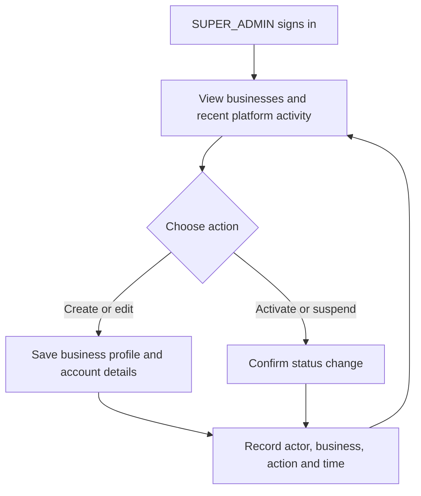
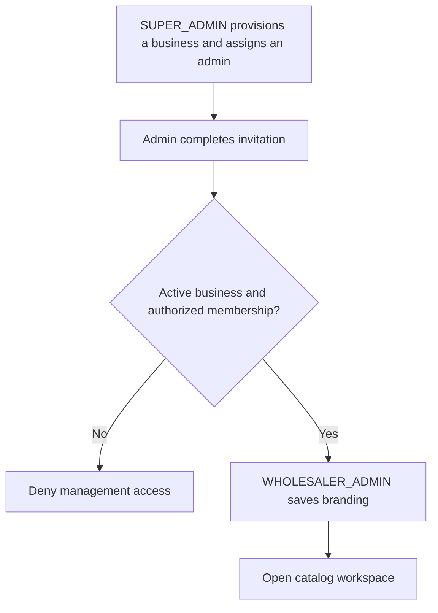
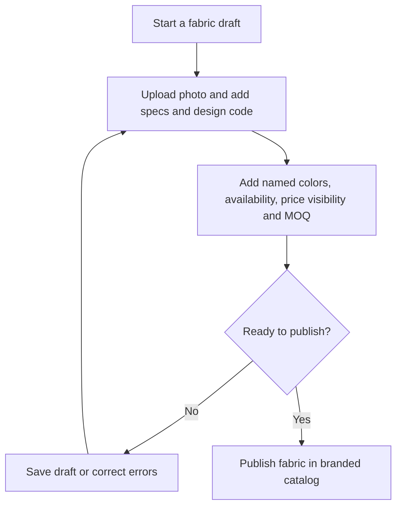
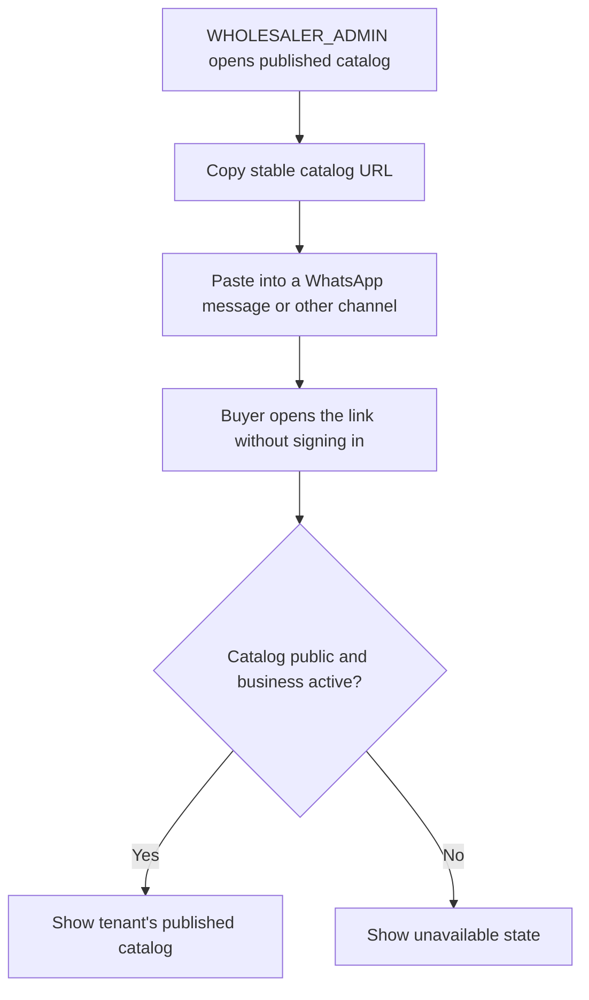
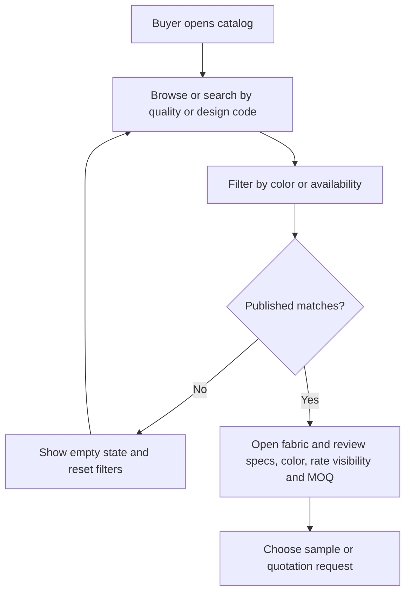
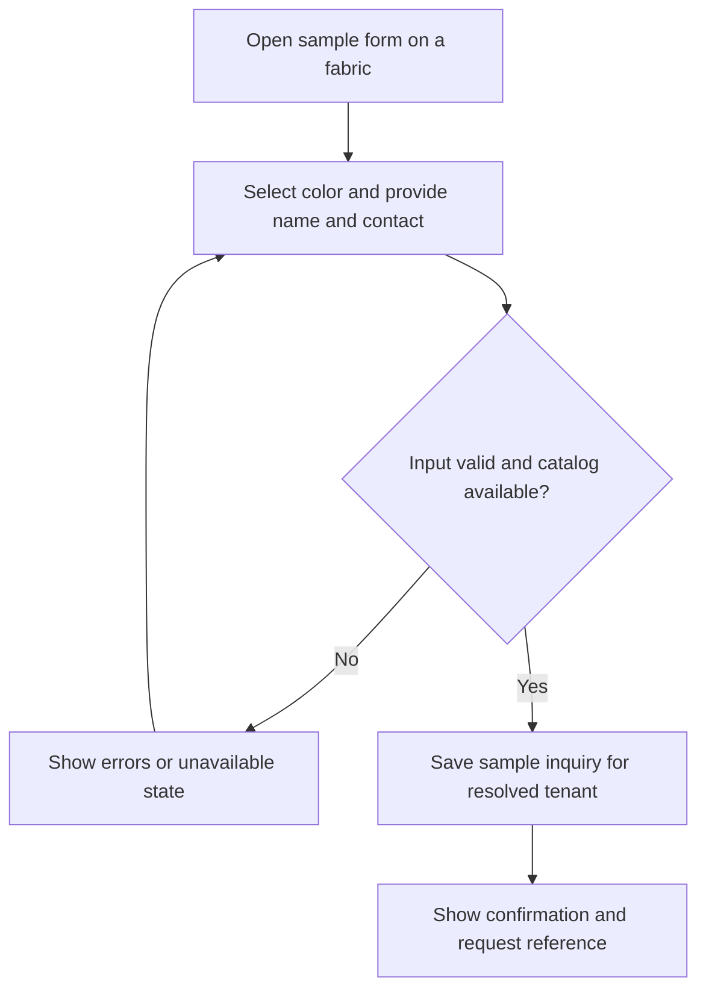
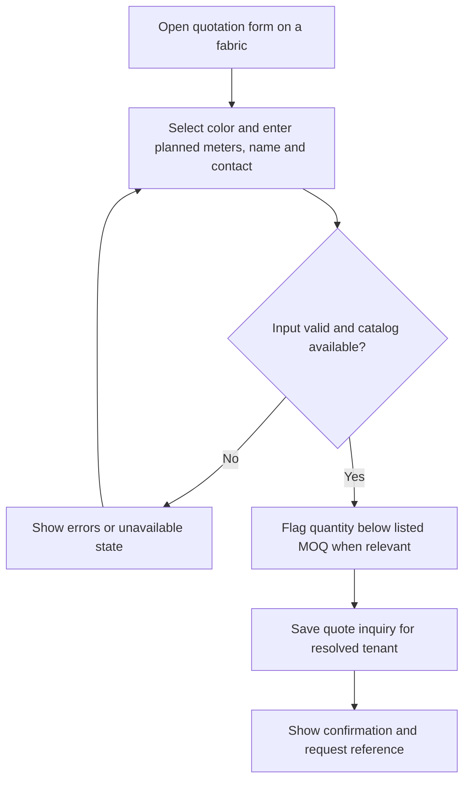
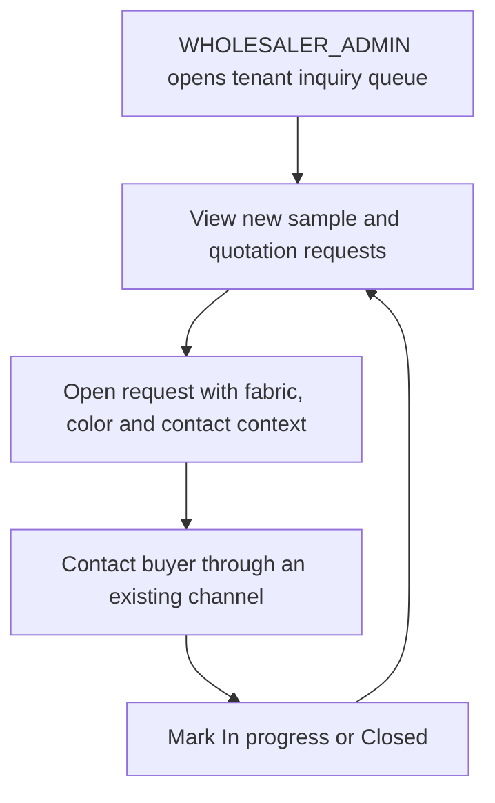

# User flows

## Existing manual workflow hypothesis

1. A buyer receives fabric photos, a forwarded PDF, or a physical catalog, or messages a wholesaler with a sourcing brief.
2. Staff recover the fabric identity from a photo, design code or sample book and check available colors, current rates and MOQ in chats, a stock sheet or with another staff member.
3. The buyer asks for missing details and decides whether to inspect a physical sample or request a bulk quote.
4. Staff record or forward the request, clarify the desired color or quantity, and follow up in chat or by phone. They may also note the request in a separate file.
5. Staff update their source and resend affected material when pricing or availability changes. Old copies may remain in circulation.

This sequence is for field testing. See the [Surat interview guide](market-validation.md).

## Proposed FabricRelay workflow

An authorized wholesaler maintains one branded catalog. Buyers open a shareable link without an account and browse published fabrics. Sample and wholesale quotation submissions appear in the same tenant’s queue. Staff respond outside FabricRelay and update status in the queue.

### 1. Super Admin management

### 2. Wholesaler onboarding

### 3. Fabric catalog creation

### 4. Catalog sharing

### 5. Buyer fabric discovery

### 6. Sample request submission

### 7. Wholesale quotation submission

### 8. Inquiry management

See the [requirements](requirements.md) for the acceptance criteria and [MVP scope](mvp-scope.md) for deferred features.
