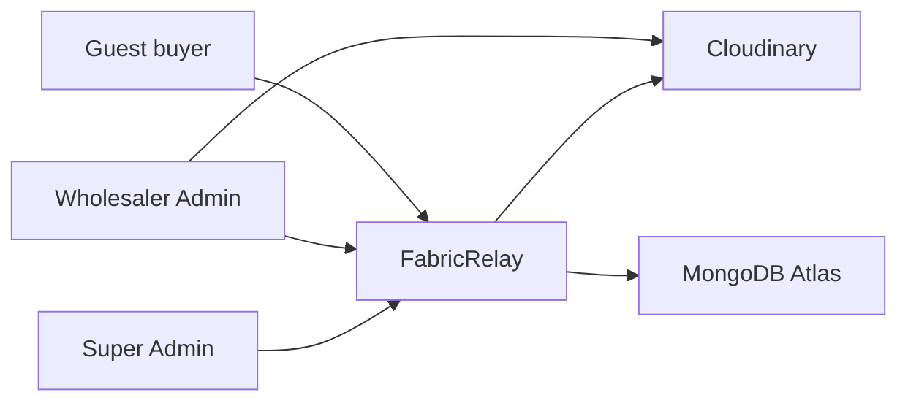
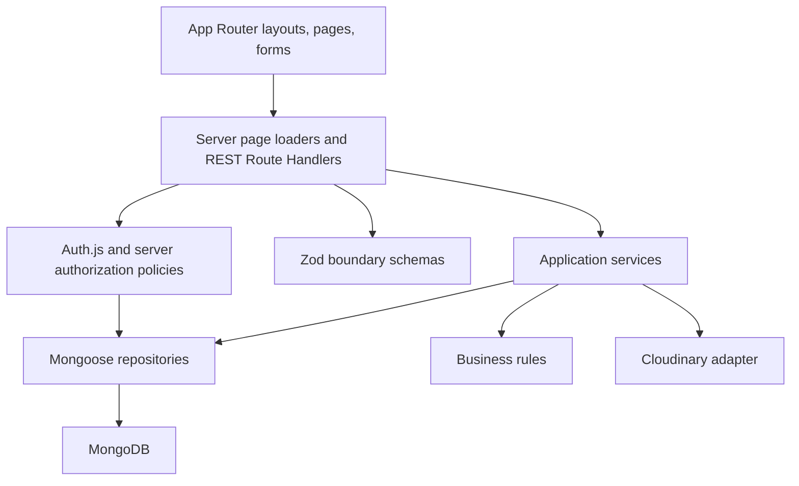
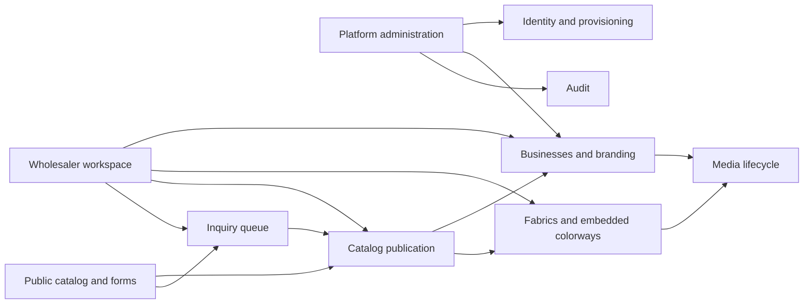
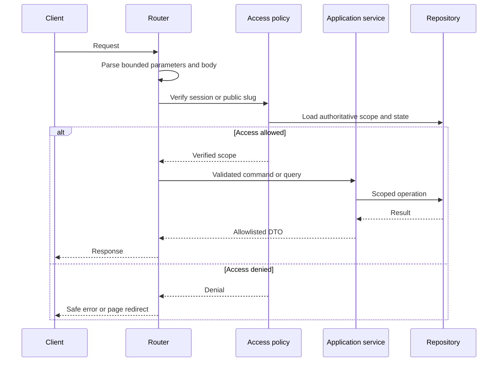
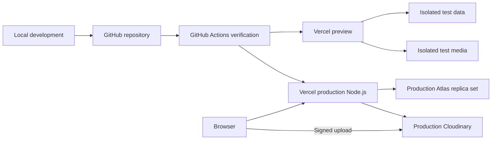

# System architecture

M02 implements the owner's approval to finalize the reviewed proposal. The [requirements](../01-understand/requirements.md) and [MVP priorities](../01-understand/mvp-scope.md) govern the release. The [implementation plan](implementation-plan.md) traces every requirement and records interpretations. The discovery documents remain the historical baseline.

## System context

## Application architecture

| Layer | Responsibilities |
| --- | --- |
| Presentation | Server Components load pages and render DTOs. Client components handle interactive filters, forms and upload progress. Route handlers translate HTTP to application calls. |
| Application | Coordinate use cases, scope checks, transactions, DTO construction, idempotency and provider calls. Page loaders call services directly without internal HTTP. |
| Business logic | Pure rules for measurement and money conversion, listing readiness, visibility, inquiry transitions and eligibility. |
| Data access | Server-only Mongoose models, named repositories, tenant filters, atomic writes and index management. |
| Authentication | Auth.js handles credential exchange and cookie lifecycle. Authorization reloads authoritative account and business state before protected use cases. |
| Validation | Strict Zod schemas parse untrusted input and reject unknown keys. Domain rules check relationships and state. Persistence validators and unique indexes protect durable invariants. |
| Integrations | MongoDB connection management and Cloudinary signing, metadata verification, optimized delivery and deletion. |

## Component architecture

Arrows indicate allowed service calls or reads. Modules communicate through typed server functions, explicit scope and DTOs. Business branding and fabrics pass target identifiers to the media service. Media receives eligibility through caller-supplied server scope and target rules, with repository-level ownership checks. Platform mutations use the audit writer in the same transaction. Avoid importing another module's model into page code or using unrestricted repository calls as a shortcut.

## Request lifecycle

The service rechecks state when an operation needs transactional consistency. Request-scoped memoization can reuse a verified principal within a single request. Private and visibility-sensitive public responses avoid shared application caches.

## Deployment architecture

One deployable unit removes service-to-service credential and release coordination costs. Separate module interfaces retain extraction options if independent scaling or ownership becomes necessary. The tradeoff is a shared deploy and database failure domain.

## Compatibility gates

Target Node.js 24 locally, in CI and on Vercel. Use the Node runtime for Auth.js, Mongoose and Cloudinary routes. Pair the selected Next.js version with its supported React and TypeScript versions and verify the React 19 and Tailwind v4 combination with generated shadcn/ui components. Check target mobile browsers against Tailwind support. At M03, pin the package manager, exact dependency versions and lockfile after checking peer dependencies, building the app, compiling Zod and Mongoose types with strict TypeScript, and running Vitest and Playwright on the chosen Node version. The current assessment is documentation-based. [Next.js installation](https://nextjs.org/docs/app/getting-started/installation) · [Vercel Node.js support](https://vercel.com/docs/functions/runtimes/node-js/node-js-versions) · [Mongoose runtime requirements](https://mongoosejs.com/docs/nextjs.html) · [shadcn/ui Tailwind guide](https://ui.shadcn.com/docs/tailwind-v4) · [Vitest](https://vitest.dev/guide/) · [Playwright CI](https://playwright.dev/docs/ci)

See the [responsibility map](folder-structure.md), [API contracts](api-contracts.md) and [deployment strategy](deployment-strategy.md).
