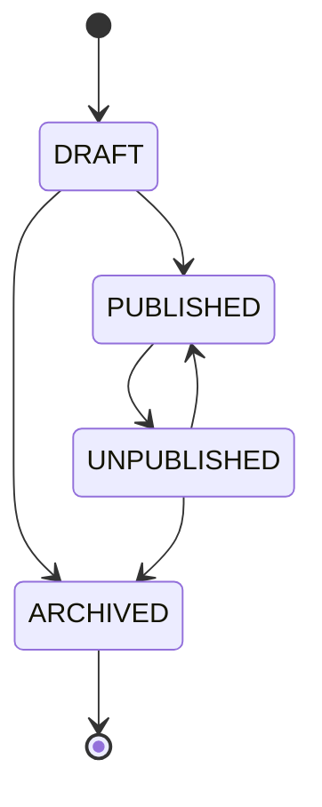

# Catalog publication and sharing

A Business owns one embedded catalog. Business lifecycle gates visibility independently from catalog state. The public catalog reads current eligible listings and current branding. Profile names may change without changing the public URL.

Publish requires an active business, valid branding and at least one publish-ready listed fabric. Listing state can be set to PUBLISHED while the catalog remains private. A listing requires a photo, specifications, design code, MOQ and at least one listed color. Editing a published listing keeps readiness intact. A catalog that subsequently has no published listings displays an accessible empty state. Unpublish before archiving a published catalog or listing. Archive is terminal and preserves identifiers and historical context. Repeated transitions to the current state are idempotent. Invalid moves return 409.

The server normalizes a proposed business slug to lowercase ASCII segments with hyphens, length 3–64. Reject reserved words and duplicate values through a unique index. Super Admin may edit a business slug before first publication. First publication locks it. Keep a locked slug reserved across suspension and archive. Use the same stability model for tenant-unique fabric slugs. Avoid slug aliases for the MVP. Share the canonical HTTPS URL /p/[businessSlug] with a copy action. Fabric URLs are nested under the resolved business.

Guest reads, inquiries and public media validate fresh state. Inactive, suspended, archived or unpublished resources return a generic unavailable response. Reactivation restores eligible previously published state. No buyer registration or inventory reservation is part of this flow. See [public contracts](api-contracts.md), [inquiry workflow](inquiry-workflow.md) and [schema](database-schema.md).
