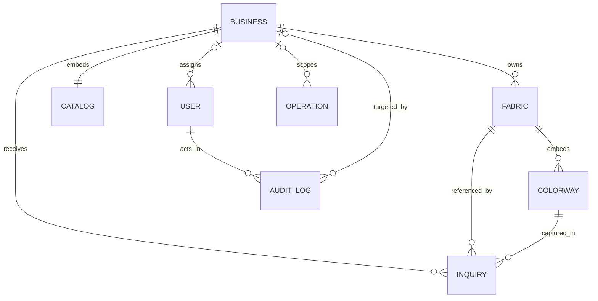

# Entity relationships

The diagram describes logical relationships. Catalog and Colorway are embedded. A wholesaler has exactly one current business and a platform user has platform scope. An inquiry is born with exactly one owning business, fabric and colorway. A later archive or pruning of a colorway leaves the inquiry snapshot readable. An audit event always records a platform actor for the MVP's platform activity and optionally targets one business. Scoped media and intake operational records require their owner. Global security counters can omit it.

A separate Colorway collection would permit independent writes and indexing but would require joins and consistency checks for routine listing edits and publication. A separate Catalog collection would duplicate one-to-one ownership and publication state. Embedding both keeps the observed read and edit paths local. See [schema and indexes](database-schema.md) and [ownership rules](tenant-isolation.md).
